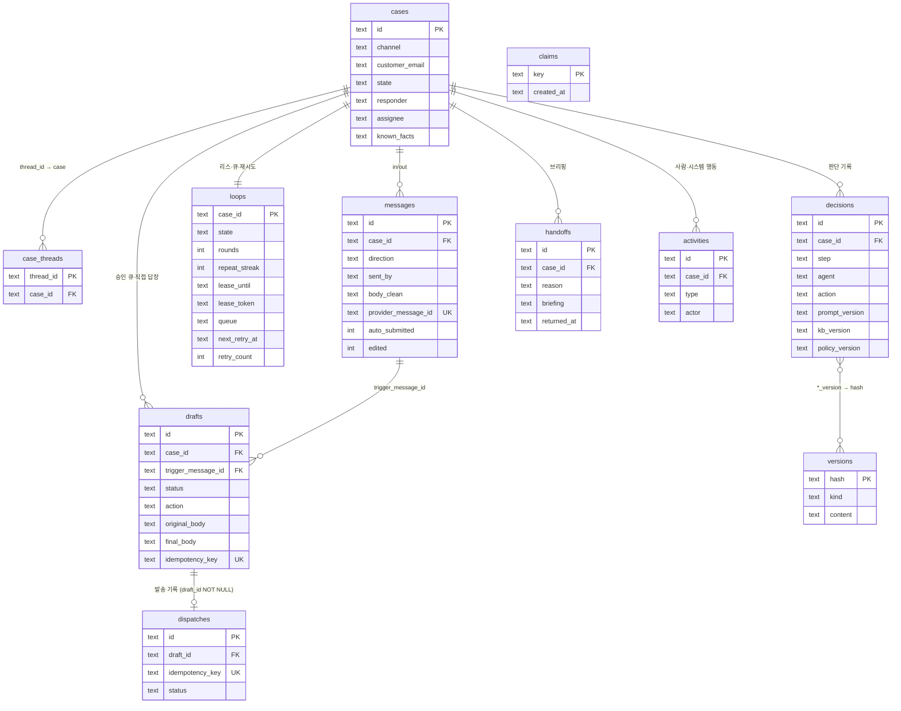

# 데이터 모델

DDL 정본은 `server/schema.sql`. 다이어그램: [`diagrams/cs-agent-data-model.html`](diagrams/cs-agent-data-model.html).
시간은 ISO 8601 문자열(UTC), id 는 `crypto.randomUUID()`. 드라이버는 동기 `node:sqlite`(`server/db.js`).

## 1. 테이블

| 테이블 | 1행 = | 핵심 열 | 왜 있나 |
|---|---|---|---|
| `cases` | 고객 문의 1건 (Aggregate) | `channel` `state` `responder`(agent/human) `assignee`(인수·폐기·직접 답장 때 `by`, 반환 때 비움) `known_facts`(JSON, 연락처 없음) | 루프·초안·넘김·멱등키가 전부 여기에 매달린다. 리드·고객 테이블 없이 케이스가 단위 |
| `case_threads` | 메일 스레드 → 케이스 매핑 | `thread_id` PK, `case_id` | 회신이 어느 케이스로 가는지. 같은 주소라고 병합하지 않는다. 수신 때 고객 스레드를 매핑하고, 발송 provider 가 다른 스레드 id 를 돌려주면 그 id 도 같은 케이스로 묶는다(spec §3 스레드) |
| `messages` | 수신·발신 메일 1통 | `direction`(in/out) `sent_by`(agent/human/ack) `body` `body_clean` `provider_message_id` UNIQUE `auto_submitted` `edited` | 원문과 인용 제거본을 둘 다. `auto_submitted` = 수신 어댑터가 자동 회신 헤더로 표시, `edited` = 사람이 고쳐 승인한 발신(사람 약속으로 취급). `sent_by=ack` = 넘김 접수 안내 — **답으로 치지 않는다**: 미답·이미 답함 판정(`server/loop.js ANSWER_OUT` — `lastOutRowid`·`answeredSince`·`lastUnanswered`)이 뺀다 |
| `claims` | 멱등 claim 1개 | `key` PK — `mailbox:<provider_message_id>`, `loop:<case_id>:<message_id>` | insert 성공 = 내가 처리. 실패 = 이미 처리됨. `mailbox:` 는 메시지 insert 와 같은 트랜잭션(실패하면 함께 롤백). 재시도·복구·반환 때는 지우고 다시 claim — 단 그 메시지 회차가 이 프로세스에서 돌고 있으면 지우지 않는다(`server/loop.js releaseForRerun`) |
| `loops` | 케이스당 루프 상태 1행 | `state` `rounds` `repeat_streak` `lease_until` **`lease_token`** `queue`(JSON) `last_outbound_gist` **`next_retry_at`** `retry_count` `retry_message_id` | 리스 10분(해제는 토큰이 맞을 때만) · 큐 · 왕복/되묻기 카운트 · LLM 장애 백오프 예약 |
| `drafts` | 발송 후보 1개 | `status` `action` `trigger_message_id` `original_body` `final_body` `edited_by` `edit_tags` `used_facts` `idempotency_key` UNIQUE `approved_by` `approved_at` `sent_at` **`seen_out_rowid`** | 승인 큐. `seen_out_rowid` = 그 초안을 쓴 회차가 맥락을 읽을 때 본 마지막 발신 `messages.rowid`(0 = 없음) — 그 뒤 발신이 있으면 승인이 `already_answered`. **사람 직접 답장도 drafts 행**(`action=HUMAN_REPLY`)이라 같은 발송 경로·멱등키를 탄다. 넘김 접수 안내도 drafts 행(`action=ACK`, SENDING 으로 시작, 실패하면 DISCARDED). `approved_by` = 승인한 사람, L2 자동 발송·접수 안내는 `agent:auto`. `action=CARRY_OVER` 기록은 decisions 에 |
| `decisions` | 루프 한 단계의 판단 1개 | `step` `agent` `output`(JSON, rule·inputs 포함) `action` `reason` `prompt_version` `kb_version` `policy_version` `latency_ms` | 감사·평가. 대시보드 "에이전트 피드"의 원천. 연락처는 마스킹해서 저장 |
| `handoffs` | 넘김 1건 | `reason` `briefing`(JSON) `assignee` `returned_at` | Briefer(또는 코드) 브리핑. `returned_at` 이 비어 있는 동안 새 초안은 ANSWER_AND_HANDOFF 로 승격된다 |
| `dispatches` | 초안당 발송 기록 1행 | `draft_id` **NOT NULL** `idempotency_key` UNIQUE `provider` `status`(SENT/FAILED) `provider_message_id` `error` | 실패하면 FAILED 로 upsert(`ON CONFLICT(idempotency_key) DO UPDATE`), 재시도 성공 시 같은 행이 SENT. 직접 답장도 draft 행이 있으니 NOT NULL 유지 |
| `activities` | 사람·시스템 행동 1건 | `type`(approve/edit_approve/discard/takeover/return/close/reopen/note/human_reply/shadow_rating/auto_close/send_unconfirmed/resolve_sending/auto_send/auto_send_failed/auto_ack) `actor` `payload` | 감사 로그. 섀도 평가·자동 종결(`auto_close.reason`: `inactive` `ignored_first_message` `declined_ack`)·발송 미확인도 여기. L2 자동 발송(`auto_send`)·자동 발송 막힘(`auto_send_failed`, payload `{draftId, error}`)·접수 안내(`auto_ack`)는 actor `agent:auto` |
| **`versions`** | 프롬프트·KB·정책 원문 1개 | `hash` PK `kind`(`prompt:<agent>` · `kb:<channel>:<lang>` · `policy:<channel>`) `content` `created_at` | decisions 의 `*_version` 해시로 "그때 무엇을 보고 판단했나"를 재현. `GET /api/versions/:hash` |

> `cases.version`(낙관적 잠금용 카운터)은 설계에 있으나 이 문서를 쓰는 시점의 `schema.sql` 에는 없다. 지금은 `server/loop.js execute` 가 쓰기 직전 `state`·`responder`·새 수신 여부를 다시 읽는 방식으로 같은 일을 한다.

## 2. 멱등·동시성을 만드는 제약

| 제약 | 막는 사고 |
|---|---|
| `claims.key` PK | 같은 메일을 두 번 수신 처리, 같은 메시지로 두 회차 |
| `messages.provider_message_id` UNIQUE | 메일 provider 재전송으로 메시지 중복 |
| `case_threads.thread_id` PK | 한 스레드가 두 케이스에 붙음 |
| `loops` 리스: `UPDATE … WHERE lease_until IS NULL OR lease_until < now` 의 영향 행 수 + `lease_token` | 한 케이스에 두 회차 동시 실행, 늦게 끝난 회차가 남의 리스를 푸는 일 |
| `drafts.status` PENDING→SENDING `UPDATE … WHERE status='PENDING'`(영향 행 수 확인) | 승인 버튼 두 번 → 두 통 |
| `drafts.idempotency_key` = `draft:<id>`(에이전트 초안 — L2 자동 발송도 같은 키) · `human:<id>`(직접 답장) · `ack:<id>`(접수 안내) UNIQUE, `dispatches.idempotency_key` UNIQUE | 발송 실패 뒤 재시도로 두 통 |
| 접수 안내는 그 케이스에 SENDING·SENT `action=ACK` 행이 없을 때만 만든다(`server/loop.js sendAck`) | 넘김이 반복될 때 접수 안내 여러 통(코드 확인 — DB 제약은 아니다) |

## 3. 관계

## 4. 상태값

- `cases.state`: `OPEN` `AGENT_ACTIVE` `AWAITING_APPROVAL` `WAITING_CUSTOMER` `HANDED_OFF` `CLOSED` — 전이는 [`diagrams/cs-agent-case-lifecycle.html`](diagrams/cs-agent-case-lifecycle.html)
- `drafts.status`: `PENDING` `SENDING` `SENT` `STALE` `DISCARDED` `NOT_SELECTED` `SHADOW` — [`diagrams/cs-agent-draft-lifecycle.html`](diagrams/cs-agent-draft-lifecycle.html). `SUPERSEDED` 는 스키마 주석에 남은 예약값이고 코드가 만들지 않는다
- `drafts.action`: gate2 결과(`DRAFT` `ANSWER_AND_HANDOFF` `SHADOW`) 또는 `HUMAN_REPLY` · `ACK`(넘김 접수 안내)
- `drafts.approved_by`: 사람 표시 이름 또는 `agent:auto`(L2 자동 발송·접수 안내). 무수정 승인률·승격 지표(`server/cases.js stats`·`promotion`)는 `agent:auto` 와 `ACK`·`HUMAN_REPLY` 를 뺀다
- `messages.sent_by`: `agent` `human` `ack`
- `loops.state`: `IDLE` `RUNNING` `HANDED_OFF`
- `decisions.step`: `prefilter` `triage` `gate1` `respond` `guard` `review` `gate2` `execute` `brief` `error`
- `decisions.action`: `IGNORE` `HANDOFF` `COMPOSE` `DRAFT` `ANSWER_AND_HANDOFF` `SHADOW` `REWRITE` `CLASSIFIED` `PASS` `FAIL` `RETRY` `CARRY_OVER` `ABORTED`

## 5. SQLite → Postgres

소규모는 컨테이너 + 영속 볼륨의 SQLite 로 충분하다. Postgres 로 옮기는 일은 **파일 하나 교체가 아니다**.

**그대로 가는 것**
- 테이블·열 이름, PK/FK/UNIQUE/INDEX 선언, `CREATE … IF NOT EXISTS`.
- 리스 획득 — 이미 조건부 UPDATE 한 번(`UPDATE loops … WHERE case_id=? AND (lease_until IS NULL OR lease_until < ?)`)이고 영향 행 수로 판정한다. 해제도 `WHERE lease_token=?`. Postgres 에서도 같은 의미.
- 초안 선점 `UPDATE drafts … WHERE status='PENDING'` 과 영향 행 수 판정.
- `dispatches` upsert 의 `INSERT … ON CONFLICT(idempotency_key) DO UPDATE`(`server/loop.js finalizeSent`·`deliver`), 발신 스레드 별칭의 `INSERT … ON CONFLICT(thread_id) DO NOTHING`(`finalizeSent`) — 두 DB 모두 같은 문법.

**바꿔야 하는 것**
| 지금 | Postgres | 이유 |
|---|---|---|
| 도착 순서를 SQLite `rowid` 로 판정(`server/loop.js` 의 STALE·새 수신·미답 메시지·`recover`·`drafts.seen_out_rowid`, `server/cases.js` 목록·상세 정렬) | `messages`·`drafts`·`decisions` 에 `seq bigserial` 추가하고 `rowid` 를 `seq` 로 | Postgres 엔 `rowid` 가 없다. 같은 ms 에 두 통이 오면 ISO 시각 비교는 틀린다 |
| 동기 `node:sqlite` — `server/` 안 `db.all/get/run/insert/tx/saveVersion` 호출 135곳(2026-10-25 집계, 리뷰 시점 77곳에서 늘었다) | DB 층 전체를 async(`await`)로, 드라이버(pg) 추가 | 동기 드라이버라 지금은 한 스레드에서 쓰기가 자연히 직렬화된다. 비동기로 바꾸면 그 가정이 사라지므로 조건부 UPDATE·UNIQUE 로만 동시성을 지킨다(위 표는 이미 그렇게 짰다) |
| `db.tx(fn)` = `BEGIN`/`COMMIT` 동기 래퍼 | 커넥션 단위 트랜잭션 | 풀에서 같은 커넥션을 잡아야 한다 |
| `changes`(영향 행 수) | `rowCount` 또는 `RETURNING id` | 선점·리스 판정에 쓴다 |
| 시각 `TEXT`(ISO) | `timestamptz` | 문자열 비교 정렬이 지금은 UTC ISO 라 맞지만, 타입으로 보장 |
| JSON 을 담은 `TEXT`(`known_facts` `queue` `edit_tags` `used_facts` `output` `briefing` `payload`) | `jsonb` | |
| `max(a, b, c)`(스칼라 max) — `server/sweeper.js autoClose`(마지막 메시지·활동 시각), `server/cases.js listCases`(`reaskedAfterHandoff` 의 넘김·응대 주체 변경 시각) | `GREATEST(a, b, c)` | SQLite 의 인자 여럿 `max` 는 스칼라 함수다. Postgres `max` 는 집계뿐 |
| `INSERT OR IGNORE INTO versions …`(`server/db.js saveVersion`) | `INSERT … ON CONFLICT (hash) DO NOTHING` | `OR IGNORE` 는 SQLite 전용 문법 |
| claim = 일반 `INSERT` 의 UNIQUE 위반을 잡아 false(`server/cases.js claim`, `server/db.js isUnique` 가 SQLite 오류 문구를 본다). `mailbox:` claim 은 수신 트랜잭션 안에서 실패해도 트랜잭션이 계속된다 | `INSERT … ON CONFLICT (key) DO NOTHING` + `rowCount` | Postgres 는 트랜잭션 안 문장이 실패하면 트랜잭션 전체가 중단(aborted)된다. 오류 문구 대신 영향 행 수로 판정 |
| 진행 중 회차·발송 표시가 프로세스 메모리(`server/loop.js` `inflight`·`sending`) | claim 행에 소유자·시각, 또는 advisory lock | 여러 프로세스로 늘리면 다른 프로세스의 진행 중 회차를 모른다 |
| 의존성 0 | `pg` 1개 추가 | |
