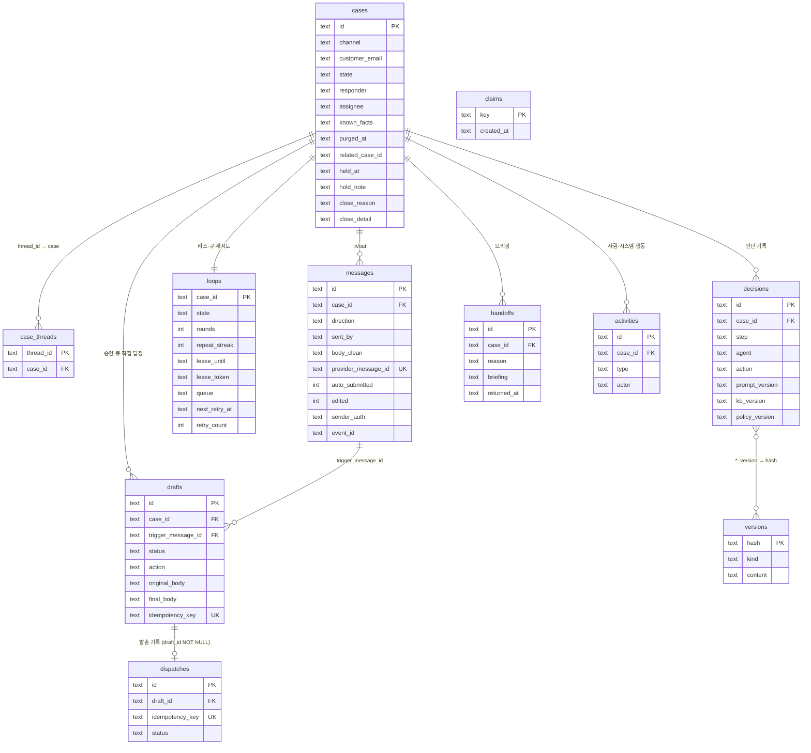

# 데이터 모델

DDL 정본은 `server/schema.sql`. 다이어그램: [`diagrams/cs-agent-data-model.html`](diagrams/cs-agent-data-model.html).
시간은 ISO 8601 문자열(UTC), id 는 `crypto.randomUUID()`. 드라이버는 동기 `node:sqlite`(`server/db.js`).

## 1. 테이블

| 테이블 | 1행 = | 핵심 열 | 왜 있나 |
|---|---|---|---|
| `cases` | 고객 문의 1건 (Aggregate) | `channel` `state` `responder`(agent/human) `assignee`(인수·폐기·직접 답장 때 `by`, 반환 때 비움) `known_facts`(JSON, 연락처 없음) `purged_at` `related_case_id` `held_at` `hold_note` `close_reason` `close_detail` | 루프·초안·넘김이 전부 여기에 매달린다. 리드·고객 테이블 없이 케이스가 단위. 종결 뒤 고객 회신은 같은 행을 다시 연다(`state=OPEN`, 종결 사유·상세 비움 — 비우기 전 값은 활동 `reopen` 에, `responder`·`assignee` 그대로 — spec 부록 F.5). 자동 회신·빈 본문은 붙기만 하고 이 행을 바꾸지 않는다. `purged_at` = 원문 파기 시각(보존 기간·정보주체 삭제) — 파기된 케이스에 대한 사람 행동은 409. `related_case_id` = 호환용으로만 남은 칼럼, 늘 NULL. `held_at`·`hold_note` = 사람 전담 케이스의 보류(메모는 가린 뒤 500자, 보류 중엔 자동 종결하지 않는다, 만료 없음). `close_reason` = 종결 사유 `resolved`·`no_response`·`duplicate`·`spam`·`not_applicable`·`other`, `close_detail` = `other` 일 때 상세(가린 뒤 500자). 전부 TEXT, 마이그레이션으로 추가 |
| `case_threads` | 메일 스레드 → 케이스 매핑 | `thread_id` PK, `case_id` | 회신이 어느 케이스로 가는지. 같은 주소라고 병합하지 않는다. 수신 때 고객 스레드를 매핑하고, 발송 provider 가 다른 스레드 id 를 돌려주면 그 id 도 같은 케이스로 묶는다(spec §3 스레드) |
| `messages` | 수신·발신 메일 1통 | `direction`(in/out) `sent_by`(agent/human/ack) `body` `body_clean` `provider_message_id` UNIQUE `auto_submitted` `edited` `sender_auth` | 원문과 인용 제거본을 둘 다. `auto_submitted` = 수신 어댑터가 자동 회신 헤더로 표시, `edited` = 사람이 고쳐 승인한 발신(사람 약속으로 취급). `sender_auth` = 수신 발신자 인증 `pass`·`fail`·`form`(폼 메일 본문에서 뽑은 주소 — 고객이 친 값이라 항상 미신뢰)·NULL(정보 없음) — `fail` 은 1차 거르기에서 넘기고, `form` 과 정보 없음(`REQUIRE_SENDER_AUTH` 켬)에는 자동 메일이 없다. `sent_by=ack` = 넘김 접수 안내 — **답으로 치지 않는다**: 미답·이미 답함 판정(`server/loop.js ANSWER_OUT` — `lastOutRowid`·`answeredSince`·`lastUnanswered`)이 뺀다. `event_id` = 수신 메일이 만든 `inbound_events` 문서 id(발신은 NULL) |
| `claims` | 멱등 claim 1개 | `key` PK — `mailbox:<provider_message_id>`, `loop:<case_id>:<message_id>` | insert 성공 = 내가 처리. 실패 = 이미 처리됨. `mailbox:` 는 메시지 insert 와 같은 트랜잭션(실패하면 함께 롤백). 재시도·복구·반환 때는 지우고 다시 claim — 단 그 메시지 회차가 이 프로세스에서 돌고 있으면 지우지 않는다(`server/loop.js releaseForRerun`) |
| `loops` | 케이스당 루프 상태 1행 | `state` `rounds` `repeat_streak` `lease_until` **`lease_token`** `queue`(JSON) `last_outbound_gist` **`next_retry_at`** `retry_count` `retry_message_id` | 리스 10분(해제는 토큰이 맞을 때만) · 큐 · 왕복/되묻기 카운트 · LLM 장애 백오프 예약 |
| `drafts` | 발송 후보 1개 | `status` `action` `trigger_message_id` `original_body` `final_body` `edited_by` `edit_tags` `used_facts` `idempotency_key` UNIQUE `approved_by` `approved_at` `sent_at` **`seen_out_rowid`** | 승인 큐. `seen_out_rowid` = 그 초안을 쓴 회차가 맥락을 읽을 때 본 마지막 발신 `messages.rowid`(0 = 없음) — 그 뒤 발신이 있으면 승인이 `already_answered`. **사람 직접 답장도 drafts 행**(`action=HUMAN_REPLY`)이라 같은 발송 경로·멱등키를 탄다. 넘김 접수 안내도 drafts 행(`action=ACK`, SENDING 으로 시작, 실패하면 DISCARDED). `approved_by` = 승인한 사람, L2 자동 발송·접수 안내는 `agent:auto`. `action=CARRY_OVER` 기록은 decisions 에 |
| `decisions` | 루프 한 단계의 판단 1개 | `step` `agent` `output`(JSON, rule·inputs 포함) `action` `reason` `prompt_version` `kb_version` `policy_version` `latency_ms` | 감사·평가. 대시보드 "에이전트 피드"의 원천. 연락처는 마스킹해서 저장 |
| `handoffs` | 넘김 1건 | `reason` `briefing`(JSON) `assignee` `returned_at` | 인계 Agent(Briefer) 또는 코드의 브리핑. `returned_at` 이 비어 있는 동안 새 초안은 ANSWER_AND_HANDOFF 로 승격된다 |
| `dispatches` | 초안당 발송 기록 1행 | `draft_id` **NOT NULL** `idempotency_key` UNIQUE `provider` `status`(SENT/FAILED) `provider_message_id` `error` | 실패하면 FAILED 로 upsert(`ON CONFLICT(idempotency_key) DO UPDATE`), 재시도 성공 시 같은 행이 SENT. 직접 답장도 draft 행이 있으니 NOT NULL 유지 |
| `activities` | 사람·시스템 행동 1건 | `type`(approve/edit_approve/discard/takeover/return/close/hold/unhold/reopen/note/human_reply/shadow_rating/auto_close/send_unconfirmed/resolve_sending/auto_send/auto_send_failed/auto_ack/purge) `actor` `payload` | 감사 로그. 섀도 평가·자동 종결(`auto_close.reason`: `inactive` `ignored_first_message` `declined_ack` `courtesy_reply`)·발송 미확인도 여기. `courtesy_reply` = 회신으로 다시 연 에이전트 케이스에 감사 인사·자동 회신만 왔을 때 답 없이 다시 닫음(종결 사유·상세는 `reopen` payload 의 원래 값으로 되돌린다). L2 자동 발송(`auto_send`)·자동 발송 막힘(`auto_send_failed`, payload `{draftId, error}`)·접수 안내(`auto_ack`)는 actor `agent:auto`. `hold` 의 payload 는 `{note}`. `reopen` = 고객 회신이 종결 케이스를 다시 엶(actor `system`, payload `{messageId, closeReason, closeDetail}` — 다시 열기 전 종결 사유·상세). 수신 이벤트에도 `matching.reasonCode=reopened_by_reply` 가 남는다. 옛 수동 재오픈(`loop.reopenCase`)도 같은 종류를 남겼으나 부르는 라우트가 없다. 원문 파기는 `purge`(payload `{reason: retention\|subject_request}`, actor `system` 또는 요청 처리자) |
| `documents` | CRM 컬렉션 문서 1개 | `(collection, id)` PK `doc`(JSON) `revision` `created_at` `updated_at` | 처리 테이블에서 다시 계산되는 투영. 컬렉션 5개(§1.1). 내용이 바뀔 때만 `revision` +1 |
| `llm_calls` | LLM 호출 1건(성공·실패 모두) | `case_id` `message_id` `agent` `provider` `model` `input_tokens`(캐시 생성·읽기 포함) `output_tokens` `latency_ms` `ok` `error`(오류 코드·HTTP 상태만) `created_at` | 비용·일일 토큰 예산·건당 지연의 출처. 본문이 없어 **FK 없이** 파기와 무관하게 남는다. `decisions.latency_ms` 와 겹치지만 실패·재시도·예산 합산은 decisions 로 안 된다 |
| **`versions`** | 프롬프트·KB·정책 원문 1개 | `hash` PK `kind`(`prompt:<agent>` · `kb:<channel>:<lang>` · `kbsrc:<channel>:<lang>` · `policy:<channel>`) `content` `created_at` | decisions 의 `*_version` 해시로 "그때 무엇을 보고 판단했나"를 재현. `GET /api/versions/:hash`. 고객 설정의 라이브 원문도 여기 든다(§1.4) |
| `config_changes` | 고객 설정 변경 1건(감사 행이자 라이브 포인터) | `seq` PK(rowid 별칭) `id` UNIQUE `kind`(`kb` · `policy`) `channel` `language` `action`(`publish` · `rollback` · `reset`) `from_hash` `to_hash` `to_sha256` `actor` `note` `summary`(JSON) `created_at` | 고객 설정이 바뀔 때마다 한 행. 대상별로 `seq` 가 가장 큰 행이 라이브를 정한다. 행을 지우지 않는다(§1.4) |
| `kb_drafts` | KB 초안 1개(직접 편집 또는 매뉴얼 변환) | `id` PK `channel` `language` `status` `origin`(`edit` · `convert`) `source_name` `source_kind` `source_text` `base_hash` `raw` `report`(JSON) `revision` `error` `created_by` `created_at` `updated_at` | 게시 전에는 라이브가 아니다. 변환 중인 초안은 저장과 게시가 막힌다(§1.4) |

**원문 파기는 제자리 가명화다.** 행을 지우지 않고(지우는 것은 회신이 다시 붙지 않게 하는 `case_threads` 행과 재시작 복구가 회차를 다시 돌리지 않게 하는 회차 claim `loop:<케이스>:…` 뿐, LLM 재시도 예약도 비운다) 본문·주소·이름·제목·자유 텍스트를 비우고, `state`·`action`·`intent`·`edit_tags`·`approved_by`·`final_body` 의 NULL 여부는 남긴다 — 무수정 승인률·승격 지표가 파기 전후 같다. `claims` 의 `mailbox:<Message-ID>` 는 중복 수신 방지에 필요해 남는다.

> `cases.version`(낙관적 잠금용 카운터)은 설계에 있으나 이 문서를 쓰는 시점의 `schema.sql` 에는 없다. 지금은 `server/loop.js execute` 가 쓰기 직전 `state`·`responder`·새 수신 여부를 다시 읽는 방식으로 같은 일을 한다.

### 1.1 CRM 컬렉션 — `documents`

`documents` 한 테이블에 컬렉션 다섯 개가 들어 있다. 문의 한 건마다 이벤트 문서가 하나 생기고, 케이스·활동·문의자·고객사 문서는 처리 테이블에서 계산한다. CRM 화면(`GET /api/crm/*`)은 이 문서만 읽는다. 예외는 승인 화면의 대기 초안(`drafts`)이다.

```sql
documents (collection TEXT, id TEXT, doc TEXT /* JSON */, revision INTEGER DEFAULT 1,
           created_at TEXT, updated_at TEXT, PRIMARY KEY (collection, id))
```

| 컬렉션 | 1문서 = | 핵심 필드 | 불변조건 |
|---|---|---|---|
| `inbound_events` | 수신 문의 한 건(원장) | `sourceType`(`email_inbound` `email_reply` `customer_support_form` `onboarding_form` `sales_inquiry_form` `manual`) `source{system, accountId, providerObjectId, threadId}` `dedupeKey` `occurredAt` `recordedAt` `rawPayload{from, name, subject, body, replyTo, inReplyTo, references, senderAuth, autoSubmitted, knownFacts}` `parsed{email, name, language, intent, caseType, caseReason, riskSignals}` `processing{status, attempts, nextRetryAt, errorCode}` `matching{status, method, reasonCode}` `resolvedCaseId` `resolvedContactId` `resolvedCompanyId` `privacy.retentionUntil` | `rawPayload`·`dedupeKey`·`occurredAt`·`recordedAt`·`source` 는 만든 뒤 바꾸지 않는다(파기 때만 비우고, `dedupeKey` 는 해시로 바꾼다 — §1.3). `dedupeKey` = `<email\|form\|manual>:<채널>:<provider 메시지 id>`(없으면 `msg:<messages.id>`)로 유일. `matching.method` = `new_case` `thread` `in_reply_to`. 종결 케이스를 다시 연 회신이면 `matching.reasonCode=reopened_by_reply`(종결 케이스에 붙기만 한 자동 회신은 null). 첫 메시지가 IGNORE 로 끝나면 `matching.status=not_applicable` |
| `contacts` | 문의자(사람) | `primaryEmail`(소문자·trim) `emails[]` `current.name{value, observedAt, sourceEventId}` `companyId` | `primaryEmail` 유일. 이름은 더 새 관찰일 때만 바꾼다. 주소가 비었거나(파기) 문의 폼 주소면 만들지 않는다 |
| `companies` | 고객사 | `primaryDomain` `canonicalName` `normalizedName` `domains[]` | `primaryDomain` 유일. 공용 메일 도메인·폼 도메인(`FORM_SENDER_DOMAINS`)·사내 도메인(`INTERNAL_DOMAINS`)은 고객사를 만들지 않는다(`companyId=null`, 개인 문의자). 이름은 폼의 `회사` 값, 없으면 도메인 |
| `cases` | 케이스(`cases.id` 와 같은 id) | `caseNumber` `recordType`(채널) `origin` `caseType` `caseReason` `intent` `priority` `status` `subStatus` `isClosed` `isEscalated` `closeReason` `closeDetail` `owner` `hold{note, since}` `relatedCaseId` `resolution{outcome, handoffReason, nextAction, lastReplyActivityId}` `attribution` `statusHistory[]` `contactId` `companyId` | `caseNumber` = 처음 투영할 때 `cases.rowid` 8자리, 이후 복사만. `statusHistory` 는 추가만이고 (status, subStatus)가 바뀔 때만 한 줄. 현재 상태 = 마지막 항목. `closeReason` 은 `Closed` 일 때만 값. 재오픈은 같은 문서에 이어지고(`statusHistory` 에 `Closed` 뒤 새 줄), `relatedCaseId` 는 호환용으로 늘 null. 상태 계산·필드 뜻은 spec 부록 F |
| `activities` | 타임라인 한 줄 | `dedupeKey`(= id) `type`(`email` `note` `status_change`) `direction`(`inbound` `outbound` `internal`) `subtype` `occurredAt` `caseId` `inboundEventId` `summary` `body` `meta` `actor` | id = `msg:<messages.id>` · `act:<activities.id>` · `handoff:<handoffs.id>`. 수신 메일 활동의 `body` 는 null(원문은 이벤트에만). 판단 트레이스(`decisions`)는 넣지 않는다. `summary` 는 코드가 만든 짧은 라벨 |

공통: `audit{createdAt, createdBy, updatedAt, updatedBy}`, `lifecycleStatus`(`active` \| `anonymized`). **문서에 현재 시각을 넣지 않는다** — 모든 시각은 원천 행에서 온다. 그래서 같은 처리 테이블 상태에서는 늘 같은 문서가 나온다.

**인덱스** (식 인덱스 — 질의가 같은 JSON 경로 리터럴을 써야 탄다. `server/store.js` 의 경로 화이트리스트가 이 리터럴을 SQL 에 직접 넣는다)

| 인덱스 | 대상 |
|---|---|
| `doc_event_dedupe` UNIQUE | `inbound_events` 의 `$.dedupeKey` |
| `doc_contact_email` UNIQUE | `contacts` 의 `$.primaryEmail` |
| `doc_company_domain` UNIQUE | `companies` 의 `$.primaryDomain`(null 제외) |
| `doc_event_case` | `inbound_events` 의 `$.resolvedCaseId` |
| `doc_activity_case` | `activities` 의 `$.caseId` |

케이스 목록은 케이스 문서를 JS 에서 거른다(상태 인덱스 없음). 케이스가 수만 건이 되면 상태 인덱스와 SQL 필터로 바꾼다(backlog B25).

### 1.2 투영 규칙

- **처리 테이블이 진실이고 문서는 거기서 결정적으로 다시 계산한 투영이다.** 문서를 지워도 `cases`·`messages`·`activities` 등에서 다시 만든다. 계산은 `require` 도 현재 시각도 없는 순수 모듈 `server/crm.js` 가 하고, DB 쪽(찾기·쓰기·dirty·flush)은 `server/collections.js` 가 한다. 프로토타입 빌드도 같은 `crm.js` 를 쓴다.
- **쓰기는 내용이 바뀔 때만.** `store.put` 은 JSON 이 같으면 아무것도 쓰지 않는다(`revision`·`updated_at` 그대로). 다르면 `revision` +1. 화면의 `expectedRevision` 이 이 값이다.
- **이벤트 문서만 수신 트랜잭션 안에서 동기로 넣는다.** `addInbound` 가 `messages` 를 넣은 직후, `message.created` 를 내기 전에 `inbound_events` 문서를 만든다. 실패하면 수신 트랜잭션째 롤백돼 어댑터 재전송이 다시 처리한다. 중복 수신이면 만들지 않는다.
- **나머지는 지연 flush.** 처리 테이블이 바뀌었다는 이벤트(`events.emit`)를 구독해 케이스 id 를 dirty 집합에 넣고 `setImmediate` 로 flush 를 한 번 예약한다. flush 는 dirty 케이스마다 자기 트랜잭션에서 `syncCase` 를 부른다. `syncCase` 는 케이스 원천 행을 전부 읽어 문의자·고객사를 찾거나 만들고, 케이스·활동 문서를 다시 계산해 `put` 하고, 그 케이스 이벤트의 결과 칸(`parsed`·`processing`·`matching`·`resolved*Id`·`retentionUntil`)을 채운다. 이벤트를 내지 않고 트랜잭션도 열지 않는다.
- **이벤트가 없거나 마지막 쓰기가 이벤트 뒤인 경로는 호출자가 dirty 표시한다.** `server/index.js` 는 `POST /api/(cases\|drafts)/:id/*` 가 끝나면(성공·실패 모두) 그 케이스를, `server/sweeper.js` 의 자동 종결은 닫은 케이스를, 감사 인사 회신의 재종결(`server/cases.js recloseCourtesy`)은 그 케이스를, 기동 복구는 발송 중이던 케이스를 표시한다.
- **읽기 전에 따라잡는다.** 목록은 flush 를 먼저 하고, 상세는 그 케이스를 dirty 로 표시해 flush 한 뒤 읽는다. `GET /api/status` 의 `crm{pending, failures, lastFlushAt}` 로 밀린 정도를 본다.
- **동기화 실패는 파기도 수신도 막지 않는다.** flush 가 예외를 잡아 로그 한 줄(케이스 id 앞 8자와 메시지, 개인정보 없음)을 남기고 `failures` 를 올리며 그 id 를 dirty 에 둔다. 자동 재예약은 없고, 다음 flush(다음 이벤트나 읽기)가 다시 한다.
- **기동 때 전체 재동기화(`resyncAll`) 한 번.** 이벤트가 없는 수신 메시지(예전 데이터)는 이벤트 문서와 `messages.event_id` 를 백필하고, 모든 케이스를 `syncCase` 한다. 메시지·케이스마다 따로 잡아 하나가 실패해도 기동은 계속된다. 주기적 재동기화는 없다.
- **`statusHistory` 는 flush 시점 표본이다.** flush 사이에 지나간 빠른 중간 상태(예: 승인 대기를 거쳐 곧바로 지나간 상태)는 한 줄로 합쳐질 수 있다. 처리 테이블과 `decisions` 에는 전부 남는다.
- 비용: 동기화마다 그 케이스 원천 행을 전부 읽고 활동 문서를 전부 다시 계산한다(케이스당 쿼리 10개 안팎). 파일럿 규모에서는 무시한다.

### 1.3 파기와 익명화

`server/retention.js purge` 는 처리 테이블을 비우는 같은 트랜잭션 끝에서 `collections.anonymizeCase` 를 부른다. 지우지 않고 제자리에서 비운다.

| 문서 | 파기 뒤 |
|---|---|
| `inbound_events` | `rawPayload` 는 키만 남기고 값 전부 null, `parsed.email`·`name` null, `source.providerObjectId`·`threadId` null, `lifecycleStatus=anonymized`. `dedupeKey` 의 provider 메시지 id 자리는 그 값의 sha256 앞 32자(hex)로 바뀐다 — 유일·결정적이라 파기 뒤 flush 가 같은 값을 낸다. provider id 가 없어 `msg:<messages.id>` 인 키는 그대로. 시각·처리 결과 코드는 남는다 |
| `cases` | `subject`·`summary`·`suppliedName`·`suppliedEmail` null, `anonymized`. `closeDetail`·`hold.note` 의 원천(`cases.close_detail`·`hold_note`)도 파기 때 NULL |
| `activities` | 원천 행(스크럽된 `activities.payload`, 빈 메시지 본문)에서 다시 계산해 본문·메모가 비고 `anonymized` |
| `contacts` | 그 주소의 파기 안 된 케이스가 하나도 없을 때만 `primaryEmail` null, `emails`·`current` 비움, `anonymized` |
| `companies` | 문서는 둔다. 이름이 폼 값에서 왔으면(도메인이 아니면) `canonicalName`·`normalizedName` 만 null |

- 케이스·활동·이벤트는 같은 트랜잭션에서 `syncCase` 로 다시 계산해 비우므로, 이후 flush 는 같은 결과를 내고 아무것도 쓰지 않는다.
- 이 동기화가 실패하면 파기는 멈추지 않는다. 그 케이스의 케이스·활동 문서를 지우고 이벤트 원문만 비운 채 dirty 로 표시해, 다음 flush 가 다시 계산한다.
- 정보주체 열람(`scripts/subject-request.js export`)은 그 케이스들의 케이스·이벤트·활동·문의자 문서를 함께 낸다.
- **수신 메일 본문은 두 곳에 있다.** `messages` 와 `inbound_events.rawPayload` 다. 보존 기간이 지난 파기와 정보주체 삭제가 둘 다 비운다. 하나만 비우면 원문이 남는다.

### 1.4 고객 설정 — `config_changes`·`kb_drafts`

고객 관리자가 콘솔에서 바꾸는 KB와 정책 팩의 저장 모델이다. 기존 테이블은 바뀌지 않는다. 두 테이블은 `CREATE TABLE IF NOT EXISTS` 로만 더해지므로 기존 DB 에도 그대로 생긴다. 정의의 정본은 `server/schema.sql` 이다.

**라이브 원문이 있는 곳**
- 대상은 두 종류다. `policy:<채널>` 과 `kb:<채널>:<언어>`. 대상마다 `config_changes` 행 가운데 `seq` 가 가장 큰 행이 라이브를 정한다. `seq` 는 `INTEGER PRIMARY KEY`(rowid 별칭)라 쓴 순서와 같고, `created_at` 은 화면 표시용이라 순서를 정하지 않는다.
- 그 행의 `action` 이 `publish` 나 `rollback` 이면 `to_hash` 가 가리키는 `versions` 행의 `content` 가 라이브 원문이다. `reset` 이거나 행이 없으면 이미지 파일(`kb/*.md`, `policy/*.json`)이 라이브다.
- 원문을 읽을 때는 `versions` 에서 `hash` 로만 찾고 `sha256(content)` 를 `to_sha256` 과 대조한다. 어긋나면 그 대상은 닫힌 쪽으로 간다. 정책은 이미지 팩을 H 로 돌리고, KB 는 빈 KB 로 본다.
- 라이브 조회 질의: `SELECT … FROM config_changes WHERE kind=? AND channel=? AND language IS ? ORDER BY seq DESC LIMIT 1`. 인덱스는 `config_changes_target(kind, channel, language)` 다.

**`versions` 규칙**
- 라이브가 된 원문만 넣는다. 초안, 변환 결과, 검사만 한 후보, 거절된 게시는 넣지 않는다. `hash` 가 PK 라 한 번 들어간 행은 고치거나 지우지 않는다.
- kind 는 세 가지를 쓴다. 정책 원문은 `policy:<채널>`, 고객 KB 원문(파일 전체)은 `kbsrc:<채널>:<언어>`, KB 유효 본문(만료 절을 뺀 것)은 `kb:<채널>:<언어>` 다. 유효 본문은 판단할 때마다 기존처럼 저장한다.
- 같은 8자리 키에 다른 내용이 이미 있으면 게시는 `409 hash_collision` 으로 거절되고 아무것도 바뀌지 않는다.

**게시 트랜잭션.** 게시, 되돌리기, 기본값 복원은 `versions` 행과 `config_changes` 행을 한 트랜잭션으로 쓴다. 감사 행 없이 라이브가 바뀌는 일은 없다. 초안을 게시하면 그 초안 행도 같은 트랜잭션에서 `published` 가 되고 `source_text` 가 지워진다. 게시 뒤의 이벤트와 접속기록은 커밋 뒤에 쓴다.

**`config_changes` 의 `summary`(JSON).** 바뀐 항목(`diff`), 경고, 게이트 판정(`gate`: 라이브 자동 발송 집합, 새 집합, 확대 항목, 막힌 구성원), L2 영향 확인 여부(`ackL2Impact`), 링크 호스트 확인 여부, 되돌리기 원본(`rollbackOf`), 초안 `draftId`, 원문 출처, KB 버전이 든다. KB 의 diff 항목은 key 와 해시만 든다. 절 본문은 넣지 않는다. `note` 는 500자로 줄이고 연락처 등을 가린 뒤 넣는다.

**`kb_drafts` 의 상태**
- `status`: `converting`(변환 중) · `ready` · `failed` · `published` · `discarded`.
- `converting` 인 초안은 저장과 게시가 `409 draft_busy` 다. 서버가 다시 뜨면 `converting` 이던 초안은 `failed`(`error='interrupted'`)가 된다.
- `base_hash` 는 초안을 시작할 때의 라이브 KB 원문 해시다. 게시할 때 라이브가 그 값과 다르면 `409 stale` 이다. `revision` 은 저장 충돌 검사용이다.
- `source_text`(매뉴얼에서 추출한 원문, 검토 화면의 대조용)는 관리자만 읽는다. 게시하거나 폐기하면 지운다. 그 밖의 초안도 `updated_at` 에서 7일이 지나면 `source_text` 를 지우고, 폐기·실패 초안은 행째 지운다. 기동 때와 sweeper 주기에 같은 정리를 한다.
- 초안 원문(`raw`)은 `versions` 에 넣지 않는다. 초안은 상태가 바뀌므로 라이브만 넣는다는 규칙과 맞지 않는다.

**관계.** `config_changes.to_hash` 는 `versions.hash` 를 가리킨다. `config_changes.summary.draftId` 는 `kb_drafts.id` 를 가리킨다. 둘 다 FK 가 없다. 고객 설정 변경 행은 원문 파기 대상이 아니고 어떤 코드도 지우지 않는다. 변환 호출은 `llm_calls` 에 agent `kb_convert` 로 남는다.

## 2. 멱등·동시성을 만드는 제약

| 제약 | 막는 사고 |
|---|---|
| `claims.key` PK | 같은 메일을 두 번 수신 처리, 같은 메시지로 두 회차 |
| `messages.provider_message_id` UNIQUE | 메일 provider 재전송으로 메시지 중복 |
| `case_threads.thread_id` PK | 한 스레드가 두 케이스에 붙음 |
| `loops` 리스: `UPDATE … WHERE lease_until IS NULL OR lease_until < now` 의 영향 행 수 + `lease_token` | 한 케이스에 두 회차 동시 실행, 늦게 끝난 회차가 남의 리스를 푸는 일 |
| `drafts.status` PENDING→SENDING `UPDATE … WHERE status='PENDING'`(영향 행 수 확인) | 승인 버튼 두 번 → 두 통 |
| `documents` PK `(collection, id)` + 유일 식 인덱스 3개(`dedupeKey`·`primaryEmail`·`primaryDomain`) | 같은 문의의 이벤트 문서 중복, 같은 주소의 문의자·같은 도메인의 고객사 중복 |
| `drafts.idempotency_key` = `draft:<id>`(에이전트 초안 — L2 자동 발송도 같은 키) · `human:<id>`(직접 답장) · `ack:<id>`(접수 안내) UNIQUE, `dispatches.idempotency_key` UNIQUE | 발송 실패 뒤 재시도로 두 통 |
| 접수 안내는 그 케이스에 SENDING·SENT `action=ACK` 행이 없을 때만 만든다(`server/loop.js sendAck`) | 넘김이 반복될 때 접수 안내 여러 통(코드 확인 — DB 제약은 아니다) |
| 파일 DB `PRAGMA busy_timeout = 5000`(`server/db.js init`, 스키마 실행 전) | 정보주체 스크립트와 서버가 같은 파일에 쓸 때 서버 쓰기가 바로 `SQLITE_BUSY` 로 실패해 회차가 넘김으로 끝나는 일 |

## 3. 관계



`documents` 도 FK 가 없다(`id` 는 처리 테이블의 id 를 그대로 쓴 값) — 처리 테이블에서 다시 계산되는 투영이다(§1.1).

`llm_calls` 는 어느 테이블에도 FK 가 없다(`case_id`·`message_id` 는 참고용 값) — 원문을 파기해도 계량 기록은 남는다.

## 4. 상태값

- `cases.state`: `OPEN` `AGENT_ACTIVE` `AWAITING_APPROVAL` `WAITING_CUSTOMER` `HANDED_OFF` `CLOSED` — 전이는 [`diagrams/cs-agent-case-lifecycle.html`](diagrams/cs-agent-case-lifecycle.html)
- `drafts.status`: `PENDING` `SENDING` `SENT` `STALE` `DISCARDED` `NOT_SELECTED` `SHADOW` — [`diagrams/cs-agent-draft-lifecycle.html`](diagrams/cs-agent-draft-lifecycle.html). `SUPERSEDED` 는 스키마 주석에 남은 예약값이고 코드가 만들지 않는다
- `drafts.action`: gate2 결과(`DRAFT` `ANSWER_AND_HANDOFF` `SHADOW`) 또는 `HUMAN_REPLY` · `ACK`(넘김 접수 안내)
- `drafts.approved_by`: 사람 표시 이름 또는 `agent:auto`(L2 자동 발송·접수 안내). 무수정 승인률·승격 지표(`server/cases.js stats`·`promotion`)는 `agent:auto` 와 `ACK`·`HUMAN_REPLY` 를 뺀다
- `cases.close_reason`: `resolved` `no_response` `duplicate` `spam` `not_applicable` `other` (NULL = 옛 데이터. 문서의 `closeReason` 은 자동 종결 활동에서 보충)
- `documents.collection`: `inbound_events` `companies` `contacts` `cases` `activities`
- `messages.sent_by`: `agent` `human` `ack`
- `messages.sender_auth`: `pass` `fail` `form` NULL(정보 없음)
- `loops.state`: `IDLE` `RUNNING` `HANDED_OFF`
- `decisions.step`: `prefilter` `triage` `gate1` `respond` `guard` `review` `gate2` `execute` `brief` `error`
- `config_changes.action`: `publish` `rollback` `reset`. `config_changes.kind`: `kb` `policy`
- `kb_drafts.status`: `converting` `ready` `failed` `published` `discarded`. `kb_drafts.origin`: `edit` `convert`
- `decisions.action`: `IGNORE` `HANDOFF` `COMPOSE` `DRAFT` `ANSWER_AND_HANDOFF` `SHADOW` `REWRITE` `CLASSIFIED` `PASS` `FAIL` `RETRY` `CARRY_OVER` `ABORTED`

## 5. SQLite → Postgres

소규모는 컨테이너 + 영속 볼륨의 SQLite 로 충분하다. Postgres 로 옮기는 일은 **파일 하나 교체가 아니다**.

**그대로 가는 것**
- 테이블·열 이름, PK/FK/UNIQUE/INDEX 선언, `CREATE … IF NOT EXISTS`.
- 리스 획득 — 이미 조건부 UPDATE 한 번(`UPDATE loops … WHERE case_id=? AND (lease_until IS NULL OR lease_until < ?)`)이고 영향 행 수로 판정한다. 해제도 `WHERE lease_token=?`. Postgres 에서도 같은 의미.
- 초안 선점 `UPDATE drafts … WHERE status='PENDING'` 과 영향 행 수 판정.
- `dispatches` upsert 의 `INSERT … ON CONFLICT(idempotency_key) DO UPDATE`(`server/loop.js finalizeSent`·`deliver`), 발신 스레드 별칭의 `INSERT … ON CONFLICT(thread_id) DO NOTHING`(`finalizeSent`) — 두 DB 모두 같은 문법.

**바꿔야 하는 것**
| 지금 | Postgres | 이유 |
|---|---|---|
| 도착 순서를 SQLite `rowid` 로 판정(`server/loop.js` 의 STALE·새 수신·미답 메시지·`recover`·`drafts.seen_out_rowid`, `server/cases.js` 목록·상세 정렬, `server/report.js workload` 의 마지막 execute 판단) | `messages`·`drafts`·`decisions` 에 `seq bigserial` 추가하고 `rowid` 를 `seq` 로 | Postgres 엔 `rowid` 가 없다. 같은 ms 에 두 통이 오면 ISO 시각 비교는 틀린다 |
| 동기 `node:sqlite` — `server/` 안 `db.all/get/run/insert/tx/saveVersion` 호출 135곳(2026-10-25 집계, 리뷰 시점 77곳에서 늘었다) | DB 층 전체를 async(`await`)로, 드라이버(pg) 추가 | 동기 드라이버라 지금은 한 스레드에서 쓰기가 자연히 직렬화된다. 비동기로 바꾸면 그 가정이 사라지므로 조건부 UPDATE·UNIQUE 로만 동시성을 지킨다(위 표는 이미 그렇게 짰다) |
| `db.tx(fn)` = `BEGIN`/`COMMIT` 동기 래퍼 | 커넥션 단위 트랜잭션 | 풀에서 같은 커넥션을 잡아야 한다 |
| `changes`(영향 행 수) | `rowCount` 또는 `RETURNING id` | 선점·리스 판정에 쓴다 |
| 시각 `TEXT`(ISO) | `timestamptz` | 문자열 비교 정렬이 지금은 UTC ISO 라 맞지만, 타입으로 보장 |
| JSON 을 담은 `TEXT`(`known_facts` `queue` `edit_tags` `used_facts` `output` `briefing` `payload`) | `jsonb` | |
| `documents` 의 식 인덱스 `json_extract(doc,'$.…')` 5개(부분 인덱스 포함) | `jsonb` 컬럼 + `(doc->>'dedupeKey')` 식 인덱스, 또는 필드별 컬럼 | 경로 리터럴이 인덱스 식과 같아야 타는 규칙은 같다 |
| `max(a, b, c)`(스칼라 max) — `server/sweeper.js autoClose`(마지막 메시지·활동 시각), `server/cases.js listCases`(`reaskedAfterHandoff` 의 넘김·응대 주체 변경 시각) | `GREATEST(a, b, c)` | SQLite 의 인자 여럿 `max` 는 스칼라 함수다. Postgres `max` 는 집계뿐 |
| `INSERT OR IGNORE INTO versions …`(`server/db.js saveVersion`) | `INSERT … ON CONFLICT (hash) DO NOTHING` | `OR IGNORE` 는 SQLite 전용 문법 |
| claim = 일반 `INSERT` 의 UNIQUE 위반을 잡아 false(`server/cases.js claim`, `server/db.js isUnique` 가 SQLite 오류 문구를 본다). `mailbox:` claim 은 수신 트랜잭션 안에서 실패해도 트랜잭션이 계속된다 | `INSERT … ON CONFLICT (key) DO NOTHING` + `rowCount` | Postgres 는 트랜잭션 안 문장이 실패하면 트랜잭션 전체가 중단(aborted)된다. 오류 문구 대신 영향 행 수로 판정 |
| 진행 중 회차·발송 표시가 프로세스 메모리(`server/loop.js` `inflight`·`sending`) | claim 행에 소유자·시각, 또는 advisory lock | 여러 프로세스로 늘리면 다른 프로세스의 진행 중 회차를 모른다 |
| 의존성 0 | `pg` 1개 추가 | |

## 6. 업무 대체율 쿼리 (`server/report.js workload`, spec 부록 G)

읽기 전용 SELECT 하나로 `messages` 한 행(한 통)을 단위 하나로 세고 `GROUP BY cases.channel, direction, 분류` 한다. 위에서부터 처음 맞는 분류를 쓴다.
- 수신(`direction='in'`)의 기준은 그 메시지의 마지막 `decisions.step='execute'` 행(`MAX(rowid)`)이다. 이 행이 없으면 분류 `pending` 이 되어 단위에서 빠지고 `pendingCount` 로만 나간다. 이 조인은 수신 행에만 건다(`m.direction='in'`). 마지막 execute 가 `IGNORE`(사유 `responder_human` 제외)이거나 `trigger_message_id` 가 그 메시지인 `action='DRAFT'` 초안이 `status='SENT'`·`approved_by='agent:auto'` 면 에이전트 처리다. execute 가 `ABORTED` 여도 그 메시지의 마지막 `prefilter`·`gate1` 행이 `IGNORE`(사유 `responder_human` 제외)면 에이전트 처리다. 종결 케이스에 붙은 자동 회신이 이 경우다.
- 수신에 `step='triage'` 판단이나 에이전트 초안(`action` 이 `ACK`·`HUMAN_REPLY` 아님, 상태 무관)이 있으면 에이전트 보조, 없으면 사람 처리다. 1차 거르기 넘김이나 사람 전담 케이스의 `responder_human` 이 여기에 든다.
- 발신(`direction='out'`)에서 `sent_by='ack'`(넘김 접수 안내)는 분류 `ack` 으로 따로 모아 단위에서 빼고 `ackCount`(전체·채널별)로만 낸다. 나머지 발신은 `sent_by` 가 `agent` 가 아니면 사람 처리다. 같은 케이스에 `sent_at = occurred_at` 인 SENT 초안이 있고 그 `approved_by='agent:auto'` 면 에이전트 처리, 아니면 에이전트 보조다. 발신 메시지 행에 초안 id 가 없어 같은 케이스·같은 시각으로 잇는다.
- 하위 질의마다 `case_id` 조건을 붙여 `decisions_case`·`drafts_case` 인덱스를 탄다. 초안의 상태 조건은 `+d.status='SENT'` 로 쓴다. 그냥 쓰면 SQLite 가 `drafts_status` 를 골라 메시지마다 SENT 초안 전부를 훑는다(`server/cases.js stats` 와 같은 방법). `test/workload.test.js` 가 `EXPLAIN QUERY PLAN` 으로 이를 확인한다. 새 인덱스·열·테이블은 없다.
- 기간은 `messages.occurred_at` 기준(`from` 이상, `to` 미만), 채널은 `cases.channel` 이다. 파기한 케이스도 행이 남아 그대로 센다.
